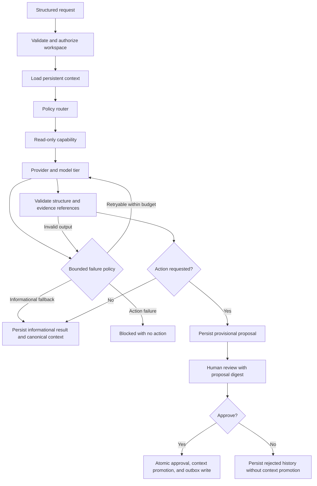

# Structured Agent Runtime

A production-style TypeScript agent runtime that turns a structured request into an evidence-backed result or a human-reviewed action. It separates model generation, deterministic capabilities, persistent context, and authority to act.

The demo analyzes synthetic workflow metrics and proposes a work ticket. **A model can propose a ticket; only an explicit human review can create it.** Nothing is sent to an external service.

## Run it

Use **Node.js 24** and npm. SQLite is provided by Node; no database service or API key is needed.

```sh
npm ci
npm run check
npm run demo
```

The CLI displays the result and exact proposed action. Type `approve` at the review prompt to write that ticket to the local SQLite outbox; any other response rejects it. Runs, context, review decisions, and tickets survive restarts in `.data/workflows.sqlite`.

The example uses a stable request ID. Running it again replays the saved result. Edit `examples/request.json` and use a **new ID** for a new workflow. Change `intent` to `research` or `drafting` to exercise the other capabilities. Set `action` to `none` for an informational result.

## Tiny HTTP example

The working endpoint in [`src/http.ts`](src/http.ts) shows how an authenticated server derives authority before calling the runtime. It uses Node's built-in HTTP server and the synthetic provider; no UI, external service, or model key is required.

Copy `.env.example` to `.env` and set `API_DEMO_TOKEN` to a random secret of at least 32 characters. Start the API:

```sh
npm run demo:api
```

In a second terminal, send the supplied synthetic request without copying the token into the command or terminal output:

```sh
node --env-file=.env --input-type=module -e '
  import { readFileSync } from "node:fs";
  const response = await fetch("http://127.0.0.1:3000/runs", {
    method: "POST",
    headers: { "Content-Type": "application/json", Authorization: `Bearer ${process.env.API_DEMO_TOKEN}` },
    body: readFileSync("examples/http-request.json", "utf8"),
  });
  console.log(response.status, await response.json());
'
```

`POST /runs` verifies the bearer credential with a constant-time digest comparison, then resolves a fixed demo principal and workspace from server-owned state. The strict JSON schema rejects client-supplied workspace, identity, and approval fields. Requests have a 16 KB body limit and a five-second request timeout; input errors return generic messages without credentials or internal errors.

The example returns `200` for an informational result and `202` for a pending proposal. Pending summaries do not enter canonical context, and this endpoint never approves or executes a proposed action. Runs persist in `.data/http-demo.sqlite`. Use a new request ID for new input; conflicting reuse returns `409`.

This is a single-client local authentication example, bound to the loopback interface. In a real application, replace the demo credential lookup with the host's verified session and server-side tenant membership lookup. Human review would require a separately authorized review flow; this example intentionally has no review endpoint.

## Architecture



## Engineering choices

- **Structured intent controls routing.** Research uses knowledge search, analysis computes metrics, and drafting loads a brief template. Analysis routes to a reasoning model tier; the other tasks use an economy tier. Policy selects capabilities rather than granting the model arbitrary tools.
- **Compute before generating.** The metric capability calculates success rates deterministically. The model explains supplied evidence rather than inventing arithmetic. Zod validates input and output, and the runtime rejects citations outside the capability's evidence set. Reference validation does not prove every sentence is factually correct.
- **Keep model providers replaceable.** A small provider interface supports a deterministic local provider and an AI SDK adapter. The latter accepts provider model objects or AI Gateway model identifiers; routing stays independent of vendor details.
- **Store context outside the model.** Bounded workspace notes and version numbers persist in SQLite. Each run records the context version it read. A saved request ID replays its result; reusing it with different input is rejected.
- **Govern memory as well as actions.** Informational results enter canonical context immediately. Consequential proposals remain provisional while pending. Approval promotes the accepted summary into context in the same transaction as the ticket and review state; rejection retains an explicitly rejected run in history without adding its summary to canonical context. Later model calls load only canonical context.
- **Separate a proposal from permission.** Every supported action requires a human review of the saved proposal digest. Approval expires after 15 minutes. Workspace checks, terminal review states, and a unique outbox key prevent cross-workspace review, approval replay, or duplicate local effects.
- **Make failures explicit.** Only transient provider errors and deadlines retry, at most three attempts. Informational workflows can return labeled deterministic evidence summaries. An action request that fails generation is blocked with no approvable action.
- **Keep telemetry narrow.** Hooks report phases, attempt counts, and timing metadata. They omit raw questions, context, model responses, and provider error details. Observer failures cannot change workflow outcomes.

## Optional live models

The default provider is synthetic and makes no network calls. For live generation, copy `.env.example` to `.env`, set an AI Gateway key and current `provider/model` identifiers for both tiers, then run:

```sh
node --env-file=.env --import tsx src/cli.ts --live
```

Choose identifiers from the [current AI Gateway model catalog](https://vercel.com/docs/ai-gateway/models-and-providers). Live calls incur provider usage. Credentials remain local and ignored by Git.

The adapter uses the installed AI SDK's `generateText` and `Output.object` APIs. Its model selection, schema configuration, cancellation, and error classification are unit tested with mocked network boundaries. Live provider connectivity is optional and is not claimed by the offline test suite.

## Verification

```sh
npm run typecheck
npm run lint
npm test
npm run build
```

Tests cover routing, real capability arithmetic, strict schema validation, persisted context, request replay, concurrent saves, cross-workspace access, restart recovery, approval integrity, expiration, rejection, provisional-memory isolation, approved-context promotion, transactional rollback, duplicate effects across SQLite connections, malformed output, ungrounded references, unrequested actions, retries, deadlines, fallback policy, and telemetry privacy. GitHub Actions runs the checks and build without credentials.

## Layout

```text
src/
  contracts.ts      Validated boundaries and provider contracts
  capabilities.ts   Policy routing and synthetic read-only tools
  providers.ts      Deterministic and AI SDK adapters
  runtime.ts        Orchestration, validation, deadlines, failure policy
  store.ts          SQLite context, run state, review, and local outbox
  cli.ts            Working local demo with explicit review
  http.ts           Authenticated POST /runs boundary
  server.ts         Local HTTP demo startup
tests/
examples/request.json
```

## Scope and operating boundaries

This is a standalone engineering showcase, built from scratch with synthetic data. It demonstrates production-oriented patterns in a small local runtime; it is not a hosted service.

The local CLI treats the person running it as the reviewer. The HTTP example demonstrates server-derived authority for one demo client; a production integration must authenticate callers and resolve workspace membership through its own identity system. The storage layer is trusted internal code, not a public API. Keep the database on durable disk; ephemeral serverless storage is unsuitable.

Approval, accepted-summary promotion, and ticket insertion share one SQLite transaction. If any write fails, all three roll back; the proposal remains pending with no new context or ticket. This guarantees a single local outbox record, not exactly-once delivery to an external API. A real dispatcher needs provider idempotency, retries, and reconciliation. Concurrent identical requests can spend inference twice before one canonical result is saved. The context version records a snapshot; it does not serialize model generation across a workspace. Add reservations and stronger context concurrency controls if that becomes a requirement.

Existing SQLite files are preserved. Summaries written to context by earlier versions are not retroactively reclassified.

Input length, context size, attempt count, response token budget, and per-call duration are bounded. A provider that ignores cancellation may continue its own work after the runtime times out. Output validation and capability isolation reduce risk; they are not a general prompt-injection defense.

MIT licensed. No production application source, business prompts, customer data, or commercial schemas are included.
